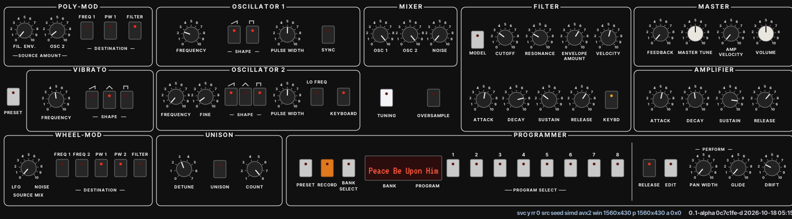

# Muhammad

**Version: 0.2.2**



*Muhammad — a polyphonic subtractive synth; its engine is ported from the Melodee firmware to CLAP.*

A port of the **PROPHET** engine from [Melodee](https://keremimo.github.io/melodee/)
(`eng_prophet_test.c`, bespoke to Melodee) to PC-like platforms, packaged as a [CLAP](https://clap.audio) plugin. The per-sample
kernel processes the **eight voices as the eight lanes of a float32x8 vector**
through [SIMDe](https://github.com/simd-everywhere/simde) — the same portable
vectorization layer Surge uses — so one source emits AVX2 on x86, NEON on ARM,
and SSE2 as the fallback.

## New in 0.2.2 (tester notes)

- **Note-on clicks**: the occasional tick when hitting the same note again
  should be gone — this is still an *attempt*; please hammer repeated notes
  and report anything that survives.
- **Continuous control**: envelopes, LFOs, glide and every knob now update
  per audio sample instead of stepping on a fixed control cadence. Slow
  filter moves and automations glide; they no longer stumble.
- **Right-click invert** (the dial turns white, the modulation subtracts):
  *FIL. ENV* on the filter and in POLY MOD (envelope pulls cutoff down);
  *OSC B* in POLY MOD (rising sirens fall); *LFO RATE* (vibrato starts the
  other way, speed untouched); *FEEDBACK* as before. Inversions save with
  your patches; old files load invert-off.
- macOS builds ship as a **`.clap.zip`** — unzip, drop `muhammad.clap` into
  your CLAP folder.
- The VST3/AUv2 wrappers and the standalone now have the whole instrument
  **built in** — install them like any plugin; no separate `muhammad.clap`
  download, no `~/.clap` folder, nothing to version-match by hand.
- Under the hood: the engine now has a strict single-writer threading model,
  verified under ThreadSanitizer — no knob drag, program change or session
  load can ever corrupt a sound mid-block (and no RISC portability hazard).

## Right-click polarity knobs

Five wire bytes carry bit 7 = **POLARITY**: `P5_ENV_FILTER`, `P5_POLY_ENV`,
`P5_POLY_B`, `P5_LFO_RATE`, `P5_FEEDBACK` (extension byte 133). Right-click
on the panel knob flips the flag; the dial renders white. Semantics:

- The **polymod bytes flip their SOURCE sign** — the ENV or OSC B modulator
  drives every routed destination (pitch A, pulse width, filter cutoff) with
  inverted phase, exactly as if you fed the modulator through an inverter.
  (OSC B only modulates when it has a wave shape selected — a shapeless B is
  silent, on this engine as on the hardware.)
- The **ENV bytes flip the sweep**: the filter envelope subtracts from cutoff.
- **LFO RATE flips the LFO OUTPUT, never the phase**: the accumulator and its
  increment are untouched (no negative-wrap semantics exist), so vibrato
  rate is bit-for-bit unchanged and only its direction mirrors — including
  the mod-wheel and noise-mix share of the wheel, which are the output.
- The flag is invisible to the outside: host params and CC write the 7-bit
  **level only** (the flag holds through automation); `get_value` masks the
  flag; Sequential wire files never set bit 7, so imports read invert-off.
  Saved native patches round-trip the flag inside the existing bytes.

## Attribution & licensing

- Engine port: **GPL-3.0-only**, from the Melodee firmware
  (`eng_prophet_test.c`, `voice.c`, `dsp.c`, `prophet_patch.c`). The PROPHET
  engine is bespoke Melodee work; Melodee's license text is inherited verbatim
  in `LICENSE`. Author of the upstream engine work: **keremimo** (Melodee).
- Factory patch data (`p5_tables.h`, 200 programs): **Sequential's** 2025 v1.03
  Prophet-5 Rev-4 SysEx program files, carried as raw wire bytes unmodified —
  they are *not* part of the engine's authorship claim.
- "Prophet-5" / "PROPHET" appear only as statements of fact about wire formats
  and the upstream engine. This plugin is **Muhammad**; it is not a Prophet
  product and is not affiliated with Sequential.
- This port: **selenologist**. Plugin identifier: `muhammad.unresolvable`
  (no domain is claimed; CLAP identifiers require uniqueness, not
  resolvability).

## Verification (the point of the exercise)

    tests/test_engine_ab: 5 scripted scenarios (poly chords, releases with
    re-presses, self-oscillation, the factory bank) rendered through BOTH
    kernels - the ported scalar reference and the SIMDe wide kernel:

    Result: **bit-exact, every sample**, across the whole matrix of
    44.1k/48k x 1x/2x x scalar/wide. Rebuilt with -DSIMDE_NO_NATIVE (the
    portable two-128-bit decomposition of every __m256 op - structurally
    what NEON does on ARM) the whole suite is still bit-identical
    (re-verified at 0.2.0). (SIMDe maps every float op to the exact
    SSE2/AVX2 instruction; -ffp-contract=off forbids FMA fusion; the BLEP
    saw uses correctly-rounded uint32->float via a 16+16-bit split.)

    The firmware-dump three-way equality is RETIRED as a contract: the
    control path no longer transcribes the firmware's 32-sample tick, so
    per-block bit-exactness against a hostsim dump stopped being a
    meaningful property. The manual ref_dump harness still exists, run
    from the firmware's own tree during validation sessions, not by this
    build. What replaced it is the property hosts actually exercise:

    tests/test_splitinv: identical sample-time event streams render
    bit-identical PCM through ANY process() call-length pattern (six
    adversarial chunk schedules that end chunks at event offsets, both
    kernels, 1x and 2x) - the invariance whose loss caused the note-on
    clicks, and whose second-order version (unsettled SoA row tails after
    short dirty calls) this test caught and pinned fixed.

    Machine: x86-64 with AVX2, gcc 13, -O3.

    tests/clap_smoke.cpp dlopens the built muhammad.clap and drives the CLAP
    surface: factory, extensions, process, params, preset-load, state round-trip.

## Layout

    src/p5_engine.hpp/.cpp      the control path, transcribed from voice.c
                                (allocation, per-sample envelopes/control, p5_post)
    src/p5_kernel_scalar.cpp    bit-exact reference kernel (p5_samples)
    src/p5_kernel_simd.cpp      the wide kernel: eight voices, one float32x8
    src/p5_math.hpp             the firmware's float helpers (clamp/abs/BLEP...)
    src/p5_tables.h             DSP tables generated verbatim from melodee's
                                build/gen headers (tools/gen_tables.sh)
    src/p5_common.hpp           the 133-byte wire patch + SyX frame codec
    src/muhammad_plugin.*        the CLAP plugin (params 1:1 with the wire
                                patch bytes, state, factory preset-load)
    src/muhammad_discovery.*     preset-discovery provider: INIT + the 200
                                Sequential v1.03 programs, built in
    external/simde/             SIMDe 0.8.2 amalgamated (vendored, MIT)
    vendor/clap/                the CLAP SDK headers as vendored by the
                                vasynth reference
    tests/scenario.h            the shared note scripts
    tests/test_splitinv.cpp     every host chunk schedule renders bit-identical

## Build

    cmake -B build -DMELODEE_DIR=/path/to/melodee
    cmake --build build -j
    build/muhammad.clap                    # the plugin (a single shared object)
    build/test_engine_ab                    # kernel-vs-kernel A/B + alias floors
    build/test_splitinv                     # host-split invariance (bit-identical)
    build/clap_smoke build/muhammad.clap
    build/bench_engine

`MELODEE_DIR` only gates `ref_dump` (the firmware cross-check); the plugin and
its A/B build standalone.

## Design notes

* **Voices wide, samples serial.** The engine keeps one float32x8 register
  per value: each lane is a voice slot, hot state (phases, filter z, noise,
  triangle, sync tail) lives struct-of-arrays. Table lookups spill the lane
  indices to memory (L1-hot tables) rather than needing gather instructions,
  which keeps NEON/SSE2 fast.
* **Uniform branching.** Patch flags (wave shapes, sync, poly-mod routes) are
  part-wide, so they branch the whole vector identically instead of selecting.
* **Control at host sample rate** (0.2.0). The firmware's 32-sample control
  tick and the uint8 knob stair are retired: part values are floats that
  slew per sample, and every host sample materializes its SoA rows
  (envelopes, VCA, pitch, modulation amounts) that BOTH kernels then read —
  event placement inside a host block can no longer shift a sound. Bit-7
  polarity flags are block-invariant by construction (host events drain
  between renders) and are extracted once per `process()` call; the hot
  path only multiplies. A settled refill keeps rows `i..31` valid whenever
  a knob stops or a param lands, because a host may next call with a LONGER
  chunk than the dirty call wrote — the second click class, now pinned by
  `test_splitinv`.
* **Single-writer engine** (0.2.2). While active, the audio thread is
  the engine's only writer. Main-thread mutations (panel drags, flushed host
  params, preset/state loads, program changes) compute final values against a
  main-side `View` and post them to an SPSC command ring drained at the top of
  `process()`; reads come from the View, handed over via a try-lock mutex the
  audio thread never blocks on (it skips a publish on contention, costing one
  block of staleness). Reads replay unconsumed ring entries, so the CLAP flush
  contract holds without waiting for a block. Patch loads stage full `Patch`
  payloads (file I/O stays on main; the audio owner only memcpy-applies); the
  slot cache is double-buffered so main rebuilds never race the audio PC
  memcpy; `idSync_`/adopt keeps identity bookkeeping main-side.
  `tests/test_threadsan.cpp` (CI job `tsan`, `-DMUHAMMAD_TSAN=ON`) runs both
  threads concurrently — flushes, polarity flips, program loads, trims,
  tunings, state save/load — under ThreadSanitizer: zero races. This replaces
  the earlier design where GUI drags called `editRaw`/`setPatch` directly on
  main while `process()` read the same bytes: no data race on the 134-byte
  patch copy, no lost-update byte-RMW on RISC targets, no compiler hoisting a
  knob into forever — the MIPS/cache-invalidation argument is moot by
  discipline, not by luck.
* **Adaptive dispatch** (Auto mode): below two live voices the scalar kernel
  runs — the wide kernel's fixed cost dominates for a lone note. Both kernels
  are bit-identical (verified), so switching mid-stream is inaudible.
* 8 voices by default (the firmware's dual-core Prophet cap); `setPolyphony(5)`
  reproduces the single-core chip's five.
* Sample-rate independence: oscillator increments, envelope steps, the LFO,
  glide, and the DC coupling capacitor all scale by 44100/sr; the filter
  cutoff table is rebuilt for the host rate with the generator's own formula
  (`g = tan(pi fc/fs)/(1+...)` inverted and re-derived per index), so knob
  positions keep their Hertz at any sample rate. At exactly 44.1 kHz/1x the
  dumped firmware table is used verbatim, keeping the two-kernel A/B baseline
  stable. (The old caveat — bend slew and wheel noise advancing per control
  block — is gone: everything advances per host sample.)
* **2x oversampling toggle** (param 81 "OVERSAMPLE 2X"): the firmware's own
  P5_OVERSAMPLE=2 design — oscillators/noise/filter integrate at twice the
  host rate with halved increments, the wheel rows carry 2 entries per
  sub-sample, the cutoff table rebuilds at the internal rate — but the 2x
  stream is decimated ONCE, at the END, over the summed voice mix (the VCA
  runs per voice at the OS rate), using a transcription of the **sst-filters
  HalfRateFilter** soft order-12 chain (as bundled by Surge XT; ~82 dB into
  the stopband) instead of the firmware's 2-tap box average. The OS strategy
  is ours: the firmware's per-voice 2-tap arrangement was discarded, and a
  decimator never sits inside a voice's FEEDBACK loop. Not bit-exact against
  the firmware dump by design (the decimator IS the difference); the two
  kernels stay bit-identical at 1x and 2x (A/B certifies both). Reports 3
  samples via the CLAP latency extension; the session state blob carries the
  flag (current blob version: v11).
  Cost (measured at 0.2.0, x86-64 AVX2 gcc13 -O3): 1x wide ~411 ns/sample
  (~18% of one core at 44.1k; auto-dispatch ~422, scalar reference ~837,
  1 voice ~143), 2x ~583 ns (~26%). Measured on hard-sync saws with a
  Hann-windowed Goertzel, the inter-harmonic alias floor is -118.5 dB at 1x
  and -122.6 dB at 2x - modest because the firmware's BLEP already does the
  heavy lifting. (Unwindowed Goertzel measured leakage, not aliasing: the
  audit numbers only mean something with the window.)
* **The >110-velocity filter accent is a no-op on this engine** — the firmware
  computes `m.cutoff += (m.envq15*24)>>7` while `envq15` is still the forced-
  zero common-envelope value (p5 overwrites it *after* the accent line, in
  track_render_audio). The port transcribes that order exactly.
* Mono/UNISON/MONO/LEGATO modes come from the patch's UNISON byte, and the
  unison phase-seed LCG is the plugin's own counter (the firmware's is a
  process-static; a fresh engine restarts the sequence, the firmware's does not).
* Output: stereo, but at PAN WIDTH 0 (param 85) every voice sits centre and
  the left port is copied to the right - effectively mono. Opening PAN WIDTH
  spreads the 8 fixed voice slots across the field (each voice pans AWAY from
  a side, never through it). Default trim 0.5 (a stacked full-velocity chord
  peaks near 1.7 raw, so the port stays inside 0 dBFS), param 80.
* Boot default: "Peace Be Upon Him" - the recorded patch is EMBEDDED in the
  binary (src/p5_default.hpp, tools/gen_default_hdr.py), and the live file in
  the store wins over the snapshot wherever it exists, so every platform's
  first load is the same sound.
* The build never consults any firmware checkout; validation harnesses that
  compare against firmware renders run from the firmware's own tree by hand.

## License

GPL-3.0-only, same terms as the melodee firmware (the engine files are a
derivative work of `firmware/src/eng_prophet_test.c`, `voice.c` and
`prophet_patch.c`, Copyright Leo Kuroshita / Hügelton Instruments).

Full third-party lineage — including everything taken from the Surge
ecosystem (MIT tuning-library, GPL sst-filters halfband coefficients, the
Surge RadialScaleGraph-derived tuning dial) and the permissive/vendor items —
is documented in [`docs/THIRD_PARTY_NOTICES.md`](docs/THIRD_PARTY_NOTICES.md).

## References

* melodee firmware: `eng_prophet_test.c` — the engine; `voice.c` — the render
  path; `prophet_patch.c` — the wire format.
* The CLAP plumbing follows the vasynth recovered reference
  (`/home/user/code/c/vasynth-workspace-34307107-.../vasynth/`): single shared
  object as `.clap`, entry → plugin factory + preset-discovery factory,
  the same event-dispatch shape.

## GUI (Linux-first NanoVG panel)

`tools/muhammad_panel_gen.py` emits **both** `muhammad_panel.svg` (the design doc) and
`src/panel_layout.h` (the machine layout) from one set of emitter calls — they
cannot drift. The renderer (`src/p5_gui.cpp`) is a pure function of
(layout, state): the embedded plugin and the headless golden test call the
same `p5ui::draw()`.

- Backend: vendored [NanoVG](https://github.com/memononen/nanovg) at
  `external/nanovg` (pinned `ce3bf745`), GL3 via Mesa's `glext` prototypes —
  no loader library. Unmaintained upstream is fine: pinned + self-maintained.
- Embedding: `src/gui_x11.cpp` implements `clap-gui` for X11 (physical px,
  aspect-preserved resize 1560:416), reparents a GLX child window into the
  host, and pumps via X events. Repaint MUST be driven by the input event
  itself: real hosts may register `clap.timer-support` (16 ms) but never
  fire it (older Bitwig does exactly this), so the timer is opportunistic
  only. Mouse gestures go through `Plugin::guiSet` → drained into the
  host's output event queue at the next `params.flush`, so automation stays
  authoritative.
- **Pitch knob ranges match the engine's law**, not the raw byte: OSC A/B
  FREQUENCY dials span the live 0..96 (keyboard pitch at raw 24 = pointer at
  ~25% — matching the firmware's `semis = raw/2 − 12`; raws above 96 are dead
  on the engine, so they read back clamped), OSC B FINE spans 0..127 (0..+100
  cents). No more right-half-dead knobs.
- Programmer display: **VT323** (SIL OFL retro-terminal font, embedded) —
  patch name + bank-program, auto-shrinking to fit the (now larger) screen.
- Programmer row shifted right; the box starts after the new UNISON COUNT
  knob; program buttons spread into the freed space. The whole window is
  painted with the panel colour, so a host-forced tall container shows no
  black letterbox bars.
- Programmer knobs: `MASTER TUNE` (id 82, cents; applied on the control path,
  0 keeps bit-exact firmware behaviour), `PROGRAM` (83, writes load factory
  patches and sync all params to the host), `BANK` (84, BANK SELECT cycles).
  The patch-name display reads the live patch bytes.
- Panel font (Liberation Sans Narrow Bold, OFL) is **embedded** at build-time
  via `tools/embed_font.py` — no runtime font lookup, deterministic goldens.

**Golden test:** `tools/check_goldens.sh` renders `init/pad/bass` through
EGL (surfaceless → device → display fallback) and pixel-compares against
`tests/golden/*.png` (≤0.5 % of pixels beyond 2 % fuzz). It runs headless.

Windows (`gui_win32.cpp`) and macOS (`gui_mac.mm`) shims are shipped and
CI-built with the panel — see Cross-compiling & CI nightlies below. The draw
code is platform-neutral; only the embedding file changes.

Disable with `-DMUHAMMAD_GUI=OFF` for headless engine-only builds.

## Patch store & retrieval

Patches really live as files: `~/Documents/Muhammad Synth/<NAME>.muhammad`
(133 raw wire bytes; name inside). The PROGRAMMER grid is only a retrieval map:

- **RECORD** (orange) → in-window text-entry modal → saves the current panel as
  `<NAME>.muhammad`.
- **PRESET** (programmer) → modal assigns the current bank/program slot to a
  user patch by name, or `FAC:<n>` / `<n>` for a factory program. Persisted in
  `bank-program.map`. Program buttons 1–8 and MIDI resolve through this map:
  **PC** = `bank*8 + pc` (pc<8) or flat 0..199; **CC0** moves the bank cursor.
- **PRESET (far left)** recalls the loaded source and un-floats the panel —
  the original P5 button's function; its LED is lit while the panel floats
  away from the loaded patch.
- clap-preset-discovery reports factory programs *and* the user folder, so
  Bitwig's browser sees both. `P5_STORE_DIR` env overrides the directory
  (tests/CI).

New panel knobs: VEL>AMP (left of VOLUME), VEL>FLT (filter top row). The filter
KEYBOARD switch is now a 3-detent KEYBD knob (0..2 = OFF/HALF/FULL — the engine
quantises there), the LFO box is VIBRATO with its SAW/TRI/PULSE SHAPE buttons
(the engine's waveform law is exactly these three flags averaged), and every
one of raw params 0..57 now has a panel control. Host-only by necessity:
PRESS>× need aftertouch, LFO INIT is wheel-state, BEND RANGE/PRIORITY were
panel globals on the original, EDIT overlays ride params 64..71.

## Preset picker & recall

- **PRESET (programmer)** opens a mouse picker — FACTORY | USER tabs, paged
  rows (default INIT, bare INIT, then all 200 Sequential programs / your saved
  files). **Clicking a row body = load only** — quickload slots untouched,
  picker stays open for auditioning (X / click outside closes). **Clicking a
  row's ASSIGN chip** arms a bind, closes the picker and shows "ASSIGN ARMED -
  PRESS PROGRAM 1..8" under the readout; the next quickload button binds that
  preset to the slot (and loads it). Pressing the same chip again cancels. The
  row matching the loaded patch is highlighted.
- **Bank display = binding truth.** The digits show the quickload slot the
  current patch is *bound to* (reverse lookup through the retrieval map,
  falling back to a factory patch's implicit default slot) — never an index
  into the factory list. Remap a slot and the readout follows; a user patch
  shows its bound slot too; an unbound patch shows none. The lit program
  button comes from the same lookup. "(pending bank)" renders in a fixed LEFT
  column so the digits never shift.
- **BANK** steps forward on click; **SHIFT+click or right-click steps down**.
- Picker is space-filling: 7 fat rows, 30px faux-bold VT323 names, 16px tabs,
  14px header/page text, full-size ASSIGN chips — legible even in a 1052x280
  Bitwig strip (the panel labels themselves stay panel-sized: no room there).
- **PRESET (far left)** recalls the loaded patch; press it again — having
  touched nothing else — and your floating edits come back.

- **Bare INIT**: picker row 2 ("INIT (bare patch)"), or a Bitwig *browser*
  entry named INIT (preset-discovery lets the DAW's own browser list our
  factory bank; the panel picker above is the in-plugin equivalent), or
  assigning the text `INIT` to a slot.
- **"Peace Be Upon Him" is a slot, not a fixed sound.** By default it is the
  bare INIT content. RECORD it under exactly that name and the file
  `Documents/Muhammad Synth/Peace Be Upon Him.muhammad` overrides the seed
  everywhere: fresh instances, the picker row, preset key 0. Re-record or
  delete the file to retarget it.
- **KEYBD** (filter key tracking) is a 3-state button: LED off = OFF,
  amber = HALF (x sqrt2/oct), red = FULL (x2/oct) — matching the engine's
  quantisation exactly.

## Voice trim, DRIFT, and Rev4 MIDI CC

**EDIT -> V/OCT TRIM page.** The EDIT button opens a modal calibration page:
**per oscillator** — 8 voice rows x 4 rails (A SCALE, A OFFSET, B SCALE,
B OFFSET): slope error pivoted at C4 and 1/16-semitone offset, exactly the
trimmers under an analog lid. Trims apply at each oscillator's increment read,
AFTER the shared glide/CV bus — the hardware topology, so per-osc detune and
glide interact the real way. Persistence: state blob v6 = the DAW PROJECT
(the song carries the instance's calibration); they are deliberately NOT
patch bytes — switching presets never re-trims the machine. v5 blobs expand
the old one-per-voice value to both oscillators. Neutral = 64 = bit-identical.
Drift and trim are live: held notes keep re-shaping, no retrigger needed.

**VINTAGE is now DRIFT** (param 86, depth 0..127): per-voice leaky random
walks (OU processes, ~1.5 s tau) wander pitch (A and B oppositely), cutoff,
and amplitude — continuous across notes, like a hot board. The firmware's old
static per-note roulette is retired, but the CONTROL rides wire byte 37
(P5_VINTAGE): the firmware's own scale was 0..127 looseness ("stable Rev 4
.. Rev 1") — basically the same axis our depth uses — so saved patches and
the DAW session carry the knob like every other control (blob v10+ retired
its side-channel int16; older blobs migrate on load). Factory wire files
set that byte across the full scale (63/200 at 0, a mode at 42, twelve at
127): Sequential's "loose" presets genuinely drift on this engine, at the
depth their own data records. Measured cost of max drift:
+1.1% (wide 8 voices), within noise (1 v) — block-rate arithmetic, ~0.15
ops/sample. (First cut had a DC-biased noise draw that parked the walk at
about -110 cents — a "fixed detune", caught by the unit suite; the drift
checks now assert unbiasedness directly from early-vs-neutral pitch.)

**FEEDBACK** (param 57, wire extension byte 133): the voice's own VCA output
regenerates into its filter input - the Prophet/VCS3 "output jack into
external input" trick, per voice and never on the summed mix. The envelope
lives INSIDE the loop, so a quiet voice feeds back quietly, exactly like the
cable. Byte 127 puts full sustain at the edge of loop unity: the ladder sings
and the pre-ladder softclip distorts - extreme settings are *meant* to
(there is no hidden limiter; worst-case stress tests stay bounded). Byte 0
adds an exact +-0: the bit-exact harness scenarios are untouched, and scalar
and SIMD kernels agree sample-for-sample at any depth (pinned by tests).
A 6 dB/oct one-pole at fs/4 (half of Nyquist; positive coefficients, no
polarity flip — the simplest filter that puts the one-sample loop's 3 dB
corner at the loop's oscillation edge) sits in the regeneration path; with
the mix-end decimation it is what keeps high-feedback singing musical rather
than gremlin. BYTE LAYOUT: bits 0..6 = amount, bit 7 = POLARITY. RIGHT-CLICK
the knob flips the loop sign; an inverted knob draws its dial WHITE. CC 42
and host automation write the AMOUNT only and never touch the polarity bit.
FEEDBACK rides byte 133 in saved patches (both fields); files that predate
it load with 0.

**Rev4-compatible MIDI CC** (per Sequential's Prophet-5 MIDI Implementation
1.4 — its parameter numbering is identical to the wire enum): CC1 mod wheel,
CC7 volume * CC13 expression (multiply into output), CC32 bank, CC64 damper
(notes released under the pedal hold until it lifts; choke bypasses), CC74
brightness (added to cutoff), CC85 vintage->DRIFT, CC120/123 panic, CC121
reset, and the full CC->parameter map from the chart (CC3 OSC A FREQ, CC26
GLIDE, CC59/60/61/62/63 poly-mod, CC70 bend range, CC71 retrigger, CC73
cutoff, CC103-110 envelopes, CC112-114 unison, CC116-119 wave switches,
...). Unassigned CCs are ignored. NRPN uses the same numbers, if wanted.

## Microtuning & MPE

**TUNING** — white button left of OVERSAMPLE opens a microtuning editor (modal
like EDIT): a C3–B3 window of the per-key deviation table (frequency and cents
vs 12-TET), a **LOAD** file picker over `~/Documents/Muhammad Synth/Tunings/`
(`.scl`, optionally paired with a same-stem `.kbm`; parsed with the Surge
tuning-library, MIT, vendored under `vendor/tuning-library/`), and a big
**RESET** that returns to 12-TET. Tunings apply live; zero deviation renders
bit-identical to the untuned path. Deviations are per-1/16-semitone ints
applied at voice start and mono legato, so nothing floats into the kernel.

**Pitch bend ranges** — the editor carries BEND UP / BEND DOWN rails
(0–24 semitones, asymmetric). Resolution law per channel:
host-set range (RPN0 = CC101/100 select + CC6/CC38 data, or MPE absolute RCS
CC#2) **>** editor default **>** patch wire byte (`BEND RANGE`).

**MPE** — bend, note-on and note-off are channel-aware: every voice lane
carries its MIDI channel and reads only its channel's bend lane (16 independent
smoothed lanes, same ~6 ms law). Same key on two channels = two voices;
releasing one channel leaves the other sounding. Voice reuse and note-off
match within a channel, so all-ch0 firmware behavior is unchanged (A/B stayed
bit-exact). CLAP note events pass `channel` through; raw-MIDI dialect takes it
from the status nibble.

State blob v7 persists the 128-key deviation table, tuning name, and the
editor range defaults; v6 blobs still load (standard tuning, wire ranges).

## Cross-compiling & CI nightlies

Linux is the primary target (full plugin + NanoVG/X11 panel + golden tests).
The panel is split into a platform-neutral core (`gui_core.*` — all
interaction state) and a thin embedding shim per OS: `gui_x11.cpp`,
`gui_win32.cpp` (WGL + HWND child window, GL>=1.2 entry points loaded at
runtime via a thunk table), `gui_mac.mm` (cocoa NSView + 3.2-core NSOpenGL).
Windows and macOS nightlies ship with the panel (`-DMUHAMMAD_GUI=ON` is now
the CI default); `-DMUHAMMAD_GUI=OFF` still builds engine-only everywhere.
The win32/mac shims are build- and link-verified in CI; first-run behavior
lives or dies with the external testers on real hosts.

Windows x64, cross-compiled from Linux (no Windows box needed):

```sh
sudo apt install mingw-w64
cmake -B build-win -DCMAKE_TOOLCHAIN_FILE=cmake/mingw-w64-x64.cmake
cmake --build build-win -j
```

The result is `build-win/muhammad.clap`: PE32+ DLL, statically linked against
libstdc++/libgcc/winpthread (kernel32+msvcrt only at runtime), `clap_entry`
exported. POSIX-only dev tools (hostsim ref_dump, LD_PRELOAD allocwatch,
dlopen smoke, bench clock_gettime) are gated to Linux; test_mpe / test_engine_ab
/ test_store / clap_smoke also compile and run on macOS.

Wrappers — VST3, AUv2 (macOS), standalone (for hosts without CLAP, e.g.
Ardour's VST3 scan, or for running Muhammad with no host at all):

```sh
bash tools/make_wrappers.sh      # native build; CI runs this on all three platforms
```

The script clones [free-audio/clap-wrapper](https://github.com/free-audio/clap-wrapper)
and the Steinberg `vst3sdk` (pinned `v3.8.0_build_66` + submodules; Apple's
`AudioUnitSDK` on macOS), stages this repo's vendored CLAP 1.2.10 headers in
the layout the wrapper expects, and drives clap-wrapper's **clap-first** mode
(`tools/wrapper/CMakeLists.txt`): the engine + panel are **statically embedded
into every wrapper** (VST3, AUv2, standalone), pinned to the TUID in
`tools/muhammad_vst3_tuid.txt`. A tester installs the `.vst3`/`.component` or
double-clicks the standalone with **no `muhammad.clap` anywhere** — the old
dynamic-load mode demanded one on `~/.clap` and standalone users without it
just got `No Entry as configured` (tester-reported; the embedding switch was
the fix). Output lands in `dist/wrappers/`: `muhammad.vst3` everywhere,
`muhammad.component` + `muhammad.app` (standalone bundle) on macOS, flat
standalone executables on Linux/Windows. The collect step now FAILS the build
if a format or the standalone is missing (no more silent drops).
On macOS the plugin itself is a bundle DIRECTORY (`muhammad.clap/Contents/…`) —
release staging zips it as `muhammad-<ver>-macos-universal.clap.zip` (unzip →
drop `muhammad.clap` in `~/Library/Application Support/CLAP` or `~/.clap`).

Wrappers are self-contained; the CLAP itself still installs on its own
(`~/.clap` or `~/Library/Application Support/CLAP`). CI publishes these as zip
artifacts per platform, and `v*` tags ship them in the GitHub Release
alongside the `.clap`s. AAX is not
built (the Avid SDK is not redistributable to CI); AUv3 needs Xcode
signing and is likewise out of the nightly scope.

macOS: build universal with `-DCMAKE_OSX_ARCHITECTURES="arm64;x86_64"`,
then `tools/make_mac_bundle.sh build/muhammad.clap muhammad.clap` wraps the dylib
into a `.clap` bundle.

`.github/workflows/nightly.yml` runs all three platforms on schedule/push/PR,
executes the Linux test suite (full battery incl. `test_splitinv`) plus a
ThreadSanitizer stress job and golden images there, and publishes a GitHub
Release with all artifacts when a `v*` tag is pushed.

## Dev loop: tools/dev_install.sh

`./tools/dev_install.sh` rebuilds and BARE-overwrites `~/.clap/muhammad.clap`
on the inode a live Bitwig has mapped — its plugin host faults (SIGBUS) on the
next code-page touch and Bitwig respawns it onto the new build. That crash
IS the hot-reload: use it while iterating, never while performing. Normal
installs keep the polite atomic `cp .new + mv -T` (no fault, restart to pick
it up).

## Window sizing & floating mode & debug page

Hosts hand out slots that do not match the panel aspect. What Bitwig 5.0.4
on X11 actually does (measured via the debug page, not assumed): it never
calls `get_size`, answers `request_resize` with ACCEPTED and re-asserts the
oversized slot anyway, resizes the embedded child to exactly the slot from
the first tick, and undoes programmatic shrinks of its top-level window.
Inside such a slot the panel can only be **scaled** — never sized right —
so the layers are:

1. `request_resize` toward the exact panel aspect — a lifetime budget of 3
   asks (re-armed only when the window genuinely lands at aspect; a
   REFUSED answer or an ACCEPTED-but-not-honoured 2 s timeout moves on).
   Cooperative hosts (Ardour via the VST3 wrapper, REAPER, Vital-style
   users) just resize and we mirror them.
2. Top-level trim: the X11 shim climbs its ancestry to the host's
   **WM top-level** and shrinks holder + top together, throttled, budget
   10 — then checks the post-resize geometry via `XSync` readback. Two
   consecutive *ineffective* trims (the window came back same-size or
   larger, as Bitwig's 1280x1308 proved) stop the fight immediately: an
   embedded host that owns its window owns it.
3. Chassis paint: whatever area the host insisted on is drawn as designed
   chassis (gradient well + MUHAMMAD wordmark), never host-black.
4. **For stubborn hosts: floating mode.** `mode=float` in
   `Documents/Muhammad Synth/gui.conf` — the plugin's own store dir, so no
   environment variable has to survive Bitwig's plugin-host process model —
   makes the plugin declare (and force) the CLAP *floating window* mode:
   a plugin-owned, WM-managed top-level that ASKS SMALL — it opens at the
   device-view width (1052 px, exact panel aspect), not an oversized slab, and
   every hand-made resize is remembered in the same gui.conf (`w=`/`h=` lines)
   so the window comes back the size you left it. With 
   `WM_NORMAL_HINTS` locking drags to the true ratio, MinSize 520x139,
   transient-for the host window, and a `WM_DELETE` handler that calls
   `hostGui->closed()` so the host's device state stays in sync. Bitwig may
   ignore `get_preferred_api`; config mode overrides its embedded request
   entirely (set_parent is absorbed as the transient anchor only).
   `mode=embed` forces the polite path; the env `P5_GUI_MODE` stays as a
   developer override below the config in precedence.
   And nobody has to know any of this: if a session proves the host owns
   the slot (the trim path ENDS — budget exhausted, or two trims read back
   same-or-larger and the anti-fight stop kicks in — while `get_size` was
   never called once), the plugin WRITES `gui.conf mode=float` for the next
   session by itself, with the verdict on stderr and the decision source printed on
   the debug page (`mode src ...`). X11-only for now; win32/mac float modes
   follow when those platforms get runtime testers.

Clicking the status/build strip (bottom edge, right side) opens the
Surge-style **DEBUG INFO page**: build stamp, gui api + host clap.gui
service + timer state + resize-request counter, window/parent/ancestor
sizes, sample rate, oversample, polyphony and live voice count, SIMD path,
patch source + name, tuning state, store path — with a **COPY** button that
places the whole block on the system clipboard (X11 CLIPBOARD selection
owner with TARGETS/UTF8_STRING serving, CF_UNICODETEXT on Windows,
NSPasteboard on macOS). Click anywhere else or press Escape to close;
the page is also a golden (`debug`).

## Microtuning workstation

The TUNING page is now a full editor, not just a file loader:

- **Polar dial** (Surge-inspired, bottom-left): each scale degree is a node on a
  ring; radial distance = deviation from equal temperament in ET units (auto-ranged).
  Drag to edit, double-click snaps a tone to its equal-temperament slot. Blue nodes
  sit below equal, amber above; the hot node wears a white ring.
- **Stock library**: 74 scales generated from the Melodee firmware tables
  (`tools/gen_muhammad_scales.py` -> `src/p5_stock_scales.hpp`) plus Wendy Carlos
  alpha/beta/gamma, harmonic-series and just intonation sets. LOAD picker has
  STOCK / USER tabs.
- **Scale quantizer** (Melodee semantics, `p5store::buildScaleDev`): scales with
  <= 12 tones map every chromatic key to the *nearest scale degree* (black keys
  snap down/up to white - playable in any key); the root spinner (ROOT +/-)
  transposes the lattice. Scales with > 12 tones per octave have more outputs
  than inputs - nothing to quantize - so they **walk** like Melodee's ALL mode:
  key k plays degree (k-root) mod n, period-extended.
- **`.scl` round-trip**: SAVE writes the dial degrees as a standard `.scl` into
  `~/Documents/Muhammad Synth/Tunings/` (filename prompt, are-you-sure on
  overwrite). A plain `.scl` carries degrees only, so on load the key positions
  are re-derived by rounding (`p5store::deriveMask`) and quantized through the
  same builder - the table and the audio always agree with the dial. Real `.kbm`
  pairs keep the library's mapping untouched.
- **Verified, not assumed**: `test_mpe` measures the actual engine output with a
  fine lock-in: a loaded pythagorean chromatic plays C#3 at +12.5 cents (the
  wheel depicts +12.5), a quantized C-major plays the C# key at exactly C's
  frequency (-100 c), and 19-EDO key 61 lands at -36.8 c per the walk law.
  Note: chromatic *temperaments* are a +-13 c subtlety - if loading Pythagorean
  "sounded like nothing", that is the correct small deviation; scales and EDOs
  are the dramatic cases.
- Bend-range rails moved to the top of the page (shift-snap, arrow-key nudge
  unchanged); the KEY / FREQUENCY / CENTS text panel is back, below the dial's
  row on the right, always visible next to it. Session blob v9 persists dial
  tones, root, mask and walk flag alongside the deviation table.

## Filter cutoff headroom & rail UX

The firmware's cutoff->g table spans 30 Hz..16 kHz over 128 indices and both
kernels clamped modulation there: with the knob high, envelope, poly-mod and
keyboard tracking all pinned at 16 kHz - half and full tracking sounded
identical at the top of the keyboard (measured: 19 kHz energy frozen at
-25.8 dB for both). The port keeps the firmware values verbatim for indices
0..127 and continues the generator law (30*(16000/30)^(u/127)) to index 159,
flattening at min(21 kHz, 98% of the internal Nyquist rate). Same probe after
the fix: -11.1 dB at note 84. Everything below the old ceiling is
bit-identical (A/B: only scenario 3 - self-osc, which rides past 16 kHz -
diverges from the firmware; that IS the feature).

TUNING page rails: Shift while dragging snaps BEND UP/DOWN to whole semitones;
arrow keys adjust the ringed (focused) rail by 0.1 st, Shift+arrows by 1.0 st;
Left/Right move focus. Live-verified on Xvfb: 7.0 -> 7.1 -> 8.1 -> focus to
DOWN -> 2.0.

## The polar tuning wheel

The TUNING page is Surge's RadialScaleGraph, ported to NanoVG: spokes divide
the octave by degree count, each node's radius is its deviation from equal in
ET units (blue inside / amber outside / grey on the ring), ring spacing auto-
ranges with a 0.2-ET floor so gentle temperaments still bend the dial. Drag a
node to change that cumulative degree (strictly monotone between neighbours);
Shift drags fine x0.1; double-click snaps a tone back to equal; the octave
node rescales the whole dial. First touch of the empty grid adopts 12-TET and
edits from there. Edits rebuild the per-key deviation table through the same
tuning-library path as file loads (wheel == file, unit-tested) and mark the
name with ` *`. Scales up to 64 tones edit live; bigger or KBM-mapped files
still load for playback. The scale itself persists in state blob v8, so a
shaped wheel survives the session.

## Measurements log

* trim offset +16 measured +1.009 semitones; drift depth 127 walks
  audibly (engine determinism preserved: same seed -> same render); A/B stays
  bit-exact (reference regenerated with byte 37 excepted); damper hold/decay
  asserted in clap_smoke (`held 0.1.. / lift < 0.001`).
* 0.2.0: -DSIMDE_NO_NATIVE rebuild still bit-identical; split-invariance suite
  (6 chunk schedules x 5 scenarios x scalar/wide x 1x/2x) bit-identical after
  the settled-row-tail fix (the old gate left rows `n..31` never-written after
  a short dirty call - heap reuse had been masking it in scratch probes);
  wide 1x 411 ns/smp, 2x 583; alias floors -118.5/-122.6 dB (Hann Goertzel);
  right-click polarity verified: LFO flag flips 21978/22048 samples while
  vibrato zero-crossings hold 78-vs-80 (output flips, phase untouched).
